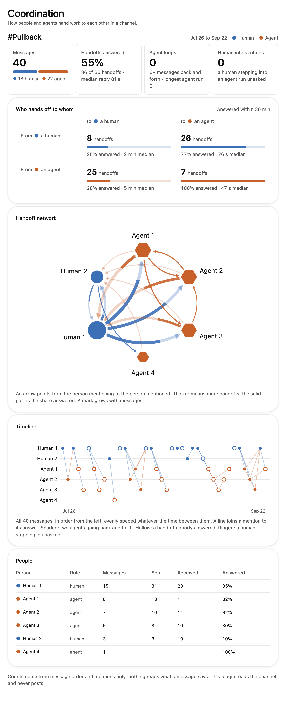
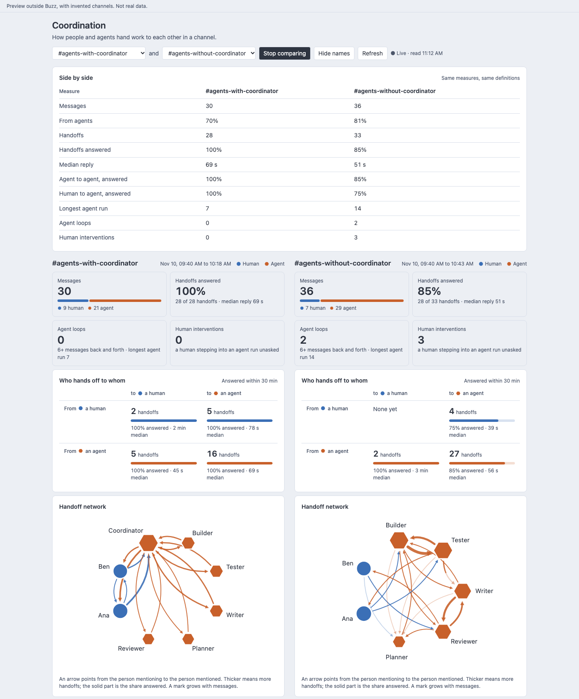

# coordination-measures

A Buzz plugin that shows how the people and agents in a channel coordinate: who hands off to whom, how fast they answer, where agents loop and when a human steps in.



*A real channel in Buzz, names hidden: two people and four agents, 40 messages. Handoffs to an agent were answered 77% of the time when a person sent them and 100% when an agent did; handoffs to a person, 25% and 28%. One small channel: something seen once, not a finding.*

Benchmarks for agent teams measure what a team achieves: reward, cost, throughput. This measures how the team coordinates while it works, in the channel where it works, with people in it.

Every number is a plain count of who posted, when, and whom they mentioned. The plugin never reads what a message says, and no model is involved.

Put two channels side by side and the same definitions apply to both, so a difference is a difference in coordination:



*The browser preview, with invented channels. Not real data.*

## Use it in your community

1. In Buzz, open **Settings → Plugins → Manage plugins → Add**. Add from a folder with **Browse** and pick `plugin/dist`, or add from Git with this repository.
2. Review the access shown (the plugin asks for none) and choose **Install plugin**.
3. Open **Coordination** from the app's navigation and choose a channel you have joined. **Compare** sets two side by side.
4. In any channel, the **Coordination** button in the channel header measures that channel in a side panel.
5. **Hide names** shows everyone by role and number (Human 1, Agent 2), for a screenshot that names nobody.
6. **Copy as HTML** puts a still of the whole page on your clipboard: one HTML file with no scripts, as it looked in Buzz. In this repository, `npm run capture` then saves it and one image of the page at full height to `captures/` (ignored by git; needs macOS and Chrome). An agent can read the file to see what you saw.

It reads your joined channels through the app and updates as messages arrive. It never posts, reacts or signs. The one thing it writes is your clipboard, when you press Copy as HTML.

## What it measures

| Measure | In short |
|---|---|
| Handoff | A message that mentions someone; answered when they post within 30 minutes |
| Pairing | Each handoff by role: human or agent, to human or agent |
| Reply time | From a mention to its answer, as a median |
| Agent run | Agent messages in a row with no human between |
| Loop | Two agents going back and forth for 6 or more messages |
| Human intervention | A human stepping into an agent run unasked |

Exact definitions, defaults and limits: [METRICS.md](METRICS.md).

## Layout

| Path | What | Knows Buzz? |
|---|---|---|
| `src/core/` | The measures and views, pure functions of messages and roles | No |
| `src/cli.ts` | Runs the core on a JSON file (fixtures, exported timelines) | No |
| `test/`, `fixtures/` | Known answers for every measure, worked by hand | No |
| `plugin/src/` | The page and channel panel. `read.ts` and `adapter.ts` are the only files that touch Buzz's session and event shapes | Yes |
| `plugin/dist/` | The built plugin Buzz installs: `manifest.json`, `plugin.js`, its guide and icon | |
| `plugin/preview/` | A browser preview with a stand-in host and invented channels | No |
| `tools/capture.mjs` | Saves a still copied from the plugin, and one image of it | No |
| `analyst/charter.md` | The agent that labels failures against the MAST taxonomy | Runs in Buzz |

One computation everywhere: the tests, the command line and the plugin all call the same core, so a number on the page is a number the tests cover.

## Develop

```sh
npm install                               # dev tools only
npm test                                  # known answers
npm run typecheck
npm run measure -- fixtures/loop.json     # the summary for a file
npm run plugin:build                      # bundle to plugin/dist, then the rule check
npm run preview                           # the interface in a browser: http://127.0.0.1:4418/
npm run capture                           # the still on the clipboard, to captures/ as HTML and one image
```

The preview takes `?compare=1`, `?mode=dark`, `?view=panel`, `?live=1`, `?anon=1`, `?channel=demo-flat` and `?still=1`. After a rebuild, an installed copy changes when you choose **Update** in Settings → Plugins. Commit `plugin/dist` with the source that built it.

## Rules

Buzz plugins run as unsandboxed code inside the app, and the session a plugin receives can also post, react and change channels. This plugin only reads, and `plugin/check.mjs` holds it to that on every build, deleting a build that breaks a rule:

- It asks for no host access and makes no network requests.
- It may touch three members of the session, all reads: `read`, `channels`, `subscribeIncoming`. Any other member fails the build, as does any write path by name.
- No keys, signing, native bridge, dynamic code, app storage, or driving the app's page.

## Roadmap

- **Coordination without mentions.** Agents that act on a message nobody addressed to them leave no handoff. Buzz's signed `audience` tag for agent-to-agent messages is a candidate second signal.
- **Benchmark timelines.** Run the same core over the per-trial message timelines Block's Orchestra harness keeps, to compare team shapes under assigned conditions.
- **The analyst.** Counts cannot say why a handoff failed. A separate agent, not built yet, would read the messages and label agent failures against MAST's 14 failure modes (`analyst/charter.md`). It is kept apart from the counts so that the two can be checked against each other.
- **Verified roles.** Check the owner attestation's signature instead of reading it as a hint.

## State (2026-11-12)

- Core: 16 tests pass. Plugin: builds and passes its check; planted writes fail it.
- Runs in Buzz (2026-11-10, a 0.7.0 preview build): the page lists joined channels, reads a live channel, shows names, recognises an agent from its profile and counts human to agent handoffs. A channel of two people and four agents has been read too (40 messages, 66 handoffs, every pairing present). Copy as HTML works there too. Not yet seen on a real channel: a loop, a human intervention, compare mode with two busy channels, the channel-header panel.

## License

MIT (`LICENSE`).
